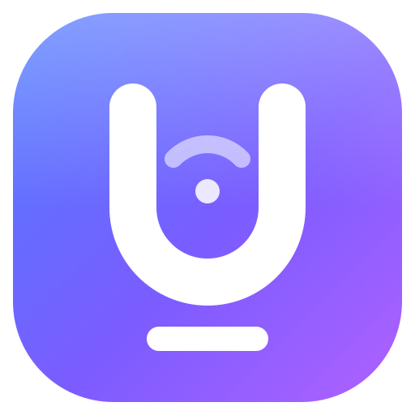
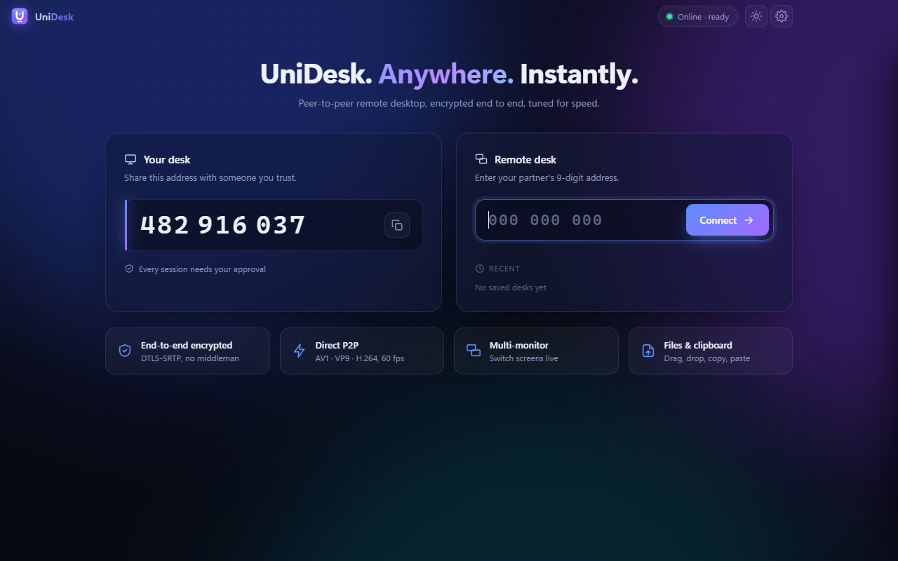
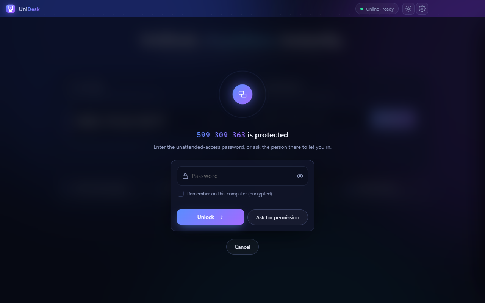
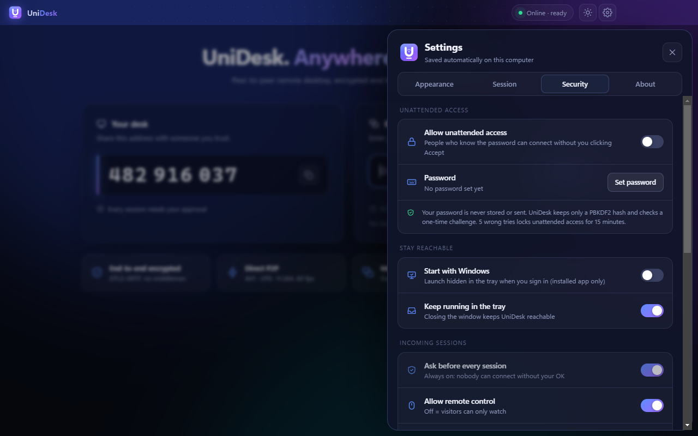

<div align="center">



# UniDesk

### UniDesk. Anywhere. Instantly.

**Free, open-source, peer-to-peer remote desktop for Windows, macOS and Linux, with a mobile viewer for phones.**<br>
A fast, private alternative to AnyDesk and TeamViewer, with unattended access, 4K 60 fps AV1 streaming, file transfer and clipboard sync.

[**Website**](https://dev-rehanify.github.io/UniDesk/) · [**Download**](https://github.com/dev-rehanify/UniDesk/releases/latest) · [**Report a bug**](https://github.com/dev-rehanify/UniDesk/issues)

   



</div>

---

## What is UniDesk?

UniDesk is a **free remote desktop app** that lets you see and control another Windows or Mac computer over the internet using a 9-digit address, just like AnyDesk or TeamViewer. There's no account, no subscription and no port forwarding. Video and input go **directly between the two computers** (peer-to-peer WebRTC), encrypted end to end, so there's no middleman server watching your screen.

## Features

| | |
|---|---|
| 📱 **Mobile viewer** | Control your computer from a phone or tablet browser: tap to click, hold to right-click, two fingers to scroll, pinch to zoom, on-screen keyboard and special keys. Send photos, files and text from the phone to the PC, receive files the PC sends, copy what the PC copied (text or images) with one tap, and chat both ways. Switch to trackpad mode for precise pointing, and restart, sleep, sign out or shut down the PC from the Power panel. Scan the QR code on the PC's home screen to open it already pointed at that PC. |
| 🐧 **Linux** | x64 AppImage with automatic updates. |
| 🔐 **End-to-end encrypted** | WebRTC DTLS-SRTP. Every session needs approval unless *you* enable unattended access. |
| ⚡ **Fast P2P streaming** | AV1 → VP9 → H.264 codec preference, up to **4K at 60 fps**, low-latency playout, live stats (codec, fps, Mbps, ping). |
| 🔢 **One-time access codes** | A temporary code (like TeamViewer's password) that works once and then changes. |
| 🗂️ **Remote file manager** | Browse the other PC's drives, download, upload into any folder, create folders, rename and delete (to the Recycle Bin): only when allowed. |
| 🕶️ **Privacy screen** | Black out the remote PC's monitors while you work; you still see the real desktop. The person there can press `Ctrl+Alt+Shift+P` to show it again (Windows). |
| ⏸️ **Pause sharing** | The host can freeze the screen (e.g. while typing a password); remote input is blocked while paused. |
| 🚫 **Block their input** | Lock the remote mouse and keyboard while you work (Windows). Lifted automatically when the session ends, control is taken back or the connection goes quiet; Ctrl+Alt+Del there always lifts it. |
| 🖼️ **Plain wallpaper** | The host's wallpaper is hidden during sessions for a faster, sharper picture, and comes back when the visitor leaves (Windows). |
| ℹ️ **Remote PC info** | Live CPU, memory, disks, battery, network, screens and uptime of the other PC, refreshed every 5 seconds. |
| 🔗 **Open a link there** | Type a web address and it opens in the other PC's browser (http/https only). |
| 📊 **Remote task manager** | See the other PC's processes with live CPU and memory, search them and end a frozen app. |
| ⏺️ **Record incoming sessions** | Optional security log: every session on your PC is saved to Videos\UniDesk\Incoming, old recordings are cleaned up after 7/30/90 days, and visitors always see a REC badge. |
| ⏻ **Sleep, sign out, shut down** | Power options for the remote PC in the Keys menu (needs control). |
| ⟳ **Restart & reconnect** | Restart the remote PC and UniDesk waits for it, then reconnects by itself. |
| 🛡️ **Allow-list** | Only accept connections from the desks you list; everyone else is turned away automatically. |
| 🔑 **Unattended access** | Password-protected access without clicking Accept. Password stored only as a PBKDF2 hash; challenge–response login; 5 wrong tries locks it for 15 min. |
| 🖥️ **Multi-monitor** | Switch remote screens from live thumbnails or with `Ctrl+Alt+←/→`. |
| 📋 **Clipboard sync** | Text **and images**: copy on one PC, paste on the other, plus **"Type my clipboard"** for password fields that block paste. |
| 📁 **File transfer** | Drag & drop files onto the remote screen, both ways. |
| 🔗 **Invite links** | Share a link; opening it launches UniDesk and connects (you still approve). |
| ✏️ **Draw on their screen** | Point things out: strokes appear on the other person's real screen and fade away. |
| 🌐 **Your own servers** | Optional custom signaling server and TURN relay for strict corporate/mobile networks. |
| 🔄 **Automatic updates** | New builds download, verify (SHA-256) and install themselves, never during a session. |
| 📶 **Live connection quality** | Signal bars and a session timer on both sides. |
| ✋ **Request control** | View-only visitors can ask for control; the host allows it with one click. |
| ✅ **Smart access requests** | Choose full control or view-only, plus files, clipboard and terminal, before accepting. Auto-declines after 30 s. |
| 🖥️ **Remote terminal** | Run PowerShell (Windows) or shell (macOS) commands on the remote PC, only when allowed. |
| ⏻ **Wake-on-LAN** | Wake sleeping PCs on your network from the address book. |
| ⌨️ **System keys** | In fullscreen, Alt+Tab and the Windows key go to the remote PC. |
| 📶 **LAN mode** | Desks on the same network find each other and connect with **no internet server at all**. |
| 🛡️ **Lock screen, UAC & Ctrl+Alt+Del** | A built-in Windows service streams the secure desktop, so visitors can unlock, approve UAC prompts and press Ctrl+Alt+Del. |
| 🏠 **Self-host kit** | One `docker compose up` gives you your own signaling server + TURN relay ([server/](server/)). |
| 💬 **Chat & voice** | Built-in peer-to-peer chat and two-way voice with echo cancellation. |
| 🎥 **Record & screenshot** | Save sessions as WebM and capture remote screenshots. |
| 🔁 **Auto-reconnect** | Recovers from dropped connections automatically. |
| 📒 **Address book** | Name, pin and search your desks, with remote PC info (name, OS, RAM, cores). Export and import it as a file to move to a new PC (passwords are never included). |
| ✎ **Text snippets** | Save commands, email addresses and other text you type often, then type them on the remote PC in one click. |
| 🛡️ **Host controls** | View-only mode, block files/clipboard, idle auto-disconnect, **lock PC when a session ends**, session history. |
| 🎨 **Beautiful UI** | Dark / light / system themes, 6 accent colours, smooth animations, reduce-motion option. |
| 🧭 **Always reachable** | Runs in the tray, optional start with Windows. |

<div align="center">
 
 
</div>

## Download & run

**Option A: download** the latest build from [Releases](https://github.com/dev-rehanify/UniDesk/releases/latest):

- **Windows:** `UniDesk-x.y.z-win-x64.exe` (installer) or the `.zip` (portable)
- **macOS:** `UniDesk-x.y.z-mac-arm64.dmg` (Apple Silicon) or `-mac-x64.dmg` (Intel)
- **Linux:** `UniDesk-x.y.z-linux-x64.AppImage`: run `chmod +x UniDesk-*.AppImage` and open it. Tested on Ubuntu 26.04 (X11); Wayland is not tested yet.
- **Phone or tablet:** no install needed. Open the [mobile viewer](https://dev-rehanify.github.io/UniDesk/m/) in Safari or Chrome, enter your computer's address and connect. Add it to your home screen to use it like an app.

> **Builds aren't code-signed yet**, so your system may warn you the first time:
> - **Windows SmartScreen** ("Windows protected your PC"): click **More info** → **Run anyway**.
> - **Windows Smart App Control** ("blocked an app that may be unsafe"): it has no "run anyway" button and no per-app exception. Unsigned apps can only run if Smart App Control is turned off (Windows Security → App & browser control → Smart App Control settings). Most PCs don't have it on. The [mobile viewer](https://dev-rehanify.github.io/UniDesk/m/) works without installing anything.
> - **macOS 15 Sequoia and later**: open UniDesk once, then go to **System Settings → Privacy & Security**, scroll down and click **Open Anyway** (right-click → Open no longer works). Then allow **Screen Recording** and **Accessibility** there so others can see and control your Mac.
> - **Linux**: run `chmod +x UniDesk-*.AppImage` first.

**Option B: run from source** (Windows or macOS, [Node.js](https://nodejs.org) 20+):

```powershell
git clone https://github.com/dev-rehanify/UniDesk.git
cd UniDesk
npm install
npm start
```

## How to connect

1. Open UniDesk on both computers.
2. On your PC, type your partner's **9-digit address** and press **Connect**.
3. Your partner clicks **Accept**, or you enter the **unattended-access password** if they set one.

## UniDesk vs AnyDesk vs TeamViewer

| | UniDesk | AnyDesk | TeamViewer |
|---|---|---|---|
| Price | **Free forever** | Free for personal use | Free for personal use |
| Open source | **Yes (MIT)** | No | No |
| Account required | **No** | No | Yes, for many features |
| Direct peer-to-peer video | **Yes** | Yes | Partly |
| Windows, macOS & Linux | Yes | Yes | Yes |
| Control from a phone | **Yes, in the browser (no app store)** | App | App |
| Unattended access | Yes | Yes | Yes |
| Self-hostable signaling | **Yes** | Enterprise only | Enterprise only |

## How it works

- **Signaling:** a PeerJS server introduces the two computers by address (only connection metadata, never your screen).
- **Media:** a WebRTC peer connection carries the screen video, audio and a data channel for input, clipboard, chat and files.
- **Input:** mouse and keyboard events are replayed on the host with [nut.js](https://github.com/nut-tree/nut.js).
- **Security:** sessions require approval; unattended access uses a PBKDF2-SHA256 verifier and HMAC challenge–response, with lockout.

## Roadmap

- [x] Custom signaling + TURN relay settings
- [ ] Code-signed installer
- [x] Windows system service (lock screen, UAC, Ctrl+Alt+Del)
- [ ] Connect before anyone signs in (after a reboot)
- [x] macOS builds (via GitHub Actions)
- [x] Linux builds (AppImage)
- [x] Mobile viewer (in the browser)

## Networking

- **Same network:** LAN mode connects directly with no server at all.
- **Over the internet:** uses the public PeerJS signaling server by default, or **your own** via the [self-host kit](server/).
- **Strict corporate / mobile networks:** add a TURN relay (the self-host kit includes one) in Settings → Network.

## Good to know

- **Runs as administrator** on Windows, so visitors can control admin apps and Task Manager.
- **Lock screen, UAC prompts and Ctrl+Alt+Del** work through the built-in **UniDesk Secure Desktop service** (installed automatically, runs as SYSTEM, localhost-only, token-protected, removed on uninstall).

## Contributing

Issues and pull requests are welcome. Please open an issue first to discuss big changes.

## License

[MIT](LICENSE) © dev-rehanify
