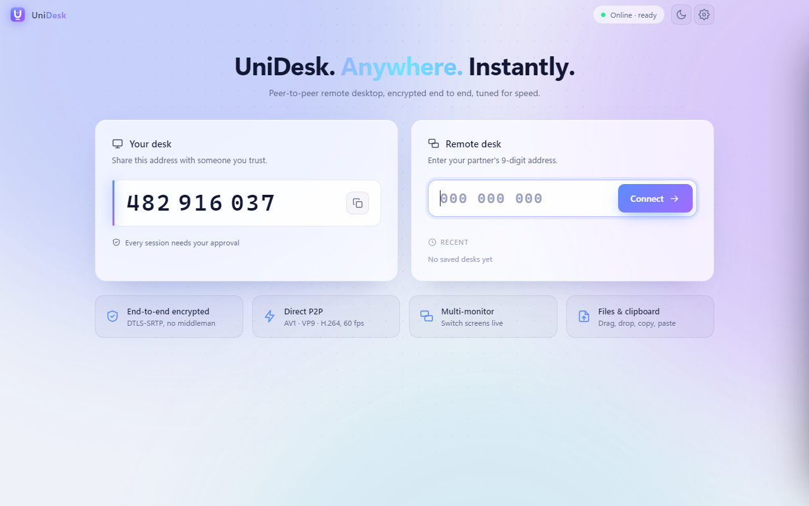
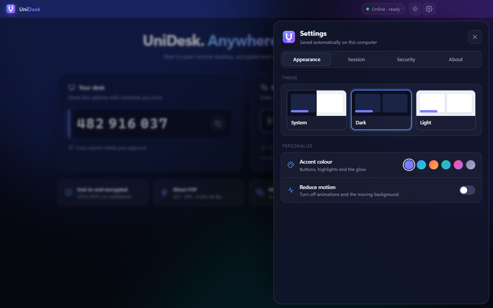

<div align="center">


# UniDesk

### UniDesk. Anywhere. Instantly.

**Free, open-source, peer-to-peer remote desktop for Windows and macOS.**<br>
A fast, private alternative to AnyDesk and TeamViewer, with unattended access, 4K 60 fps AV1 streaming, file transfer and clipboard sync.

[**Website**](https://dev-rehanify.github.io/UniDesk/) · [**Download**](https://github.com/dev-rehanify/UniDesk/releases/latest) · [**Report a bug**](https://github.com/dev-rehanify/UniDesk/issues)

   


</div>

---

## What is UniDesk?

UniDesk is a **free remote desktop app** that lets you see and control another Windows or Mac computer over the internet using a 9-digit address, just like AnyDesk or TeamViewer. There's no account, no subscription and no port forwarding. Video and input go **directly between the two computers** (peer-to-peer WebRTC), encrypted end to end, so there's no middleman server watching your screen.

## Features

| | |
|---|---|
| 🔐 **End-to-end encrypted** | WebRTC DTLS-SRTP. Every session needs approval unless *you* enable unattended access. |
| ⚡ **Fast P2P streaming** | AV1 → VP9 → H.264 codec preference, up to **4K at 60 fps**, low-latency playout, live stats (codec, fps, Mbps, ping). |
| 🔑 **Unattended access** | Password-protected access without clicking Accept. Password stored only as a PBKDF2 hash; challenge–response login; 5 wrong tries locks it for 15 min. |
| 🖥️ **Multi-monitor** | Switch remote screens from live thumbnails or with `Ctrl+Alt+←/→`. |
| 📋 **Clipboard sync** | Copy on one PC, paste on the other, plus **"Type my clipboard"** for password fields that block paste. |
| 📁 **File transfer** | Drag & drop files onto the remote screen, both ways. |
| 🔗 **Invite links** | Share a link; opening it launches UniDesk and connects (you still approve). |
| ✏️ **Draw on their screen** | Point things out: strokes appear on the other person's real screen and fade away. |
| 🌐 **Your own servers** | Optional custom signaling server and TURN relay for strict corporate/mobile networks. |
| 🔄 **Automatic updates** | New builds download, verify (SHA-256) and install themselves, never during a session. |
| 📶 **LAN mode** | Desks on the same network find each other and connect with **no internet server at all**. |
| 🛡️ **Admin & UAC** | Run as administrator and let visitors answer UAC prompts (Windows). |
| 🏠 **Self-host kit** | One `docker compose up` gives you your own signaling server + TURN relay ([server/](server/)). |
| 💬 **Chat** | Built-in peer-to-peer chat. |
| 🎥 **Record & screenshot** | Save sessions as WebM and capture remote screenshots. |
| 🔁 **Auto-reconnect** | Recovers from dropped connections automatically. |
| 📒 **Address book** | Name, pin and reorder your desks, with remote PC info (name, OS, RAM, cores). |
| 🛡️ **Host controls** | View-only mode, block files/clipboard, idle auto-disconnect, **lock PC when a session ends**, session history. |
| 🎨 **Beautiful UI** | Dark / light / system themes, 6 accent colours, smooth animations, reduce-motion option. |
| 🧭 **Always reachable** | Runs in the tray, optional start with Windows. |

<div align="center">
 
 
</div>

## Download & run

**Option A: download** the latest build from [Releases](https://github.com/dev-rehanify/UniDesk/releases/latest):

- **Windows:** `UniDesk-x.y.z-win-x64.exe` (installer) or the `.zip` (portable)
- **macOS:** `UniDesk-x.y.z-mac-arm64.dmg` (Apple Silicon) or `-mac-x64.dmg` (Intel)

> Builds aren't code-signed yet. On Windows, SmartScreen / Smart App Control may warn or block it. On macOS, right-click the app and choose **Open** the first time, then allow **Screen Recording** and **Accessibility** in System Settings → Privacy & Security so others can see and control your Mac.

**Option B: run from source** (Windows or macOS, [Node.js](https://nodejs.org) 20+):

```powershell
git clone https://github.com/dev-rehanify/UniDesk.git
cd UniDesk
npm install
npm start
```

## How to connect

1. Open UniDesk on both computers.
2. On your PC, type your partner's **9-digit address** and press **Connect**.
3. Your partner clicks **Accept**, or you enter the **unattended-access password** if they set one.

## UniDesk vs AnyDesk vs TeamViewer

| | UniDesk | AnyDesk | TeamViewer |
|---|---|---|---|
| Price | **Free forever** | Free for personal use | Free for personal use |
| Open source | **Yes (MIT)** | No | No |
| Account required | **No** | No | Yes, for many features |
| Direct peer-to-peer video | **Yes** | Yes | Partly |
| Windows & macOS | Yes | Yes | Yes |
| Unattended access | Yes | Yes | Yes |
| Self-hostable signaling | **Yes** | Enterprise only | Enterprise only |

## How it works

- **Signaling:** a PeerJS server introduces the two computers by address (only connection metadata, never your screen).
- **Media:** a WebRTC peer connection carries the screen video, audio and a data channel for input, clipboard, chat and files.
- **Input:** mouse and keyboard events are replayed on the host with [nut.js](https://github.com/nut-tree/nut.js).
- **Security:** sessions require approval; unattended access uses a PBKDF2-SHA256 verifier and HMAC challenge–response, with lockout.

## Roadmap

- [x] Custom signaling + TURN relay settings
- [ ] Code-signed installer
- [ ] Windows system service (lock screen, Ctrl+Alt+Del, connect before sign-in)
- [x] macOS builds (via GitHub Actions)
- [ ] Linux builds
- [ ] Mobile viewer

## Networking

- **Same network:** LAN mode connects directly with no server at all.
- **Over the internet:** uses the public PeerJS signaling server by default, or **your own** via the [self-host kit](server/).
- **Strict corporate / mobile networks:** add a TURN relay (the self-host kit includes one) in Settings → Network.

## Good to know

- **UAC prompts:** supported when UniDesk runs as administrator with "Let visitors answer UAC prompts" on.
- **Lock screen & Ctrl+Alt+Del:** Windows only allows these from a signed system service; this is on the roadmap.

## Contributing

Issues and pull requests are welcome. Please open an issue first to discuss big changes.

## License

[MIT](LICENSE) © dev-rehanify
